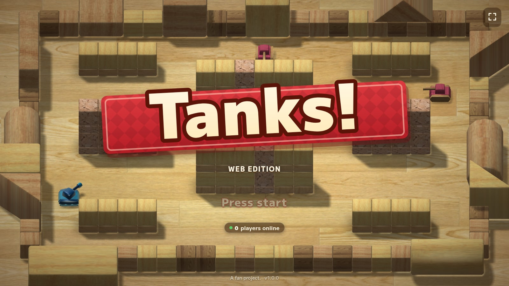
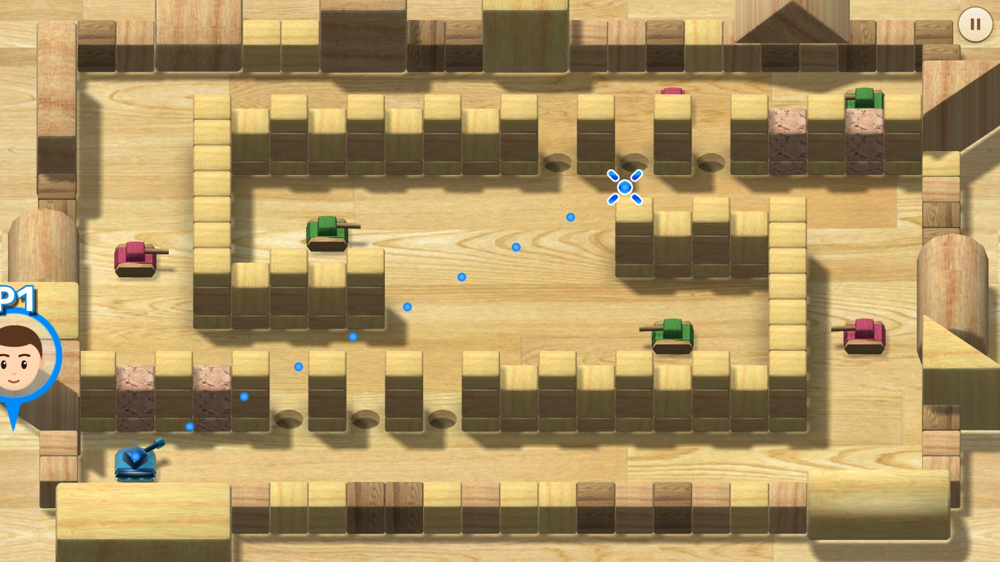
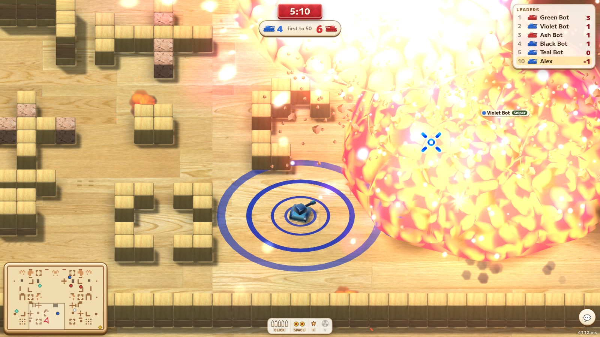
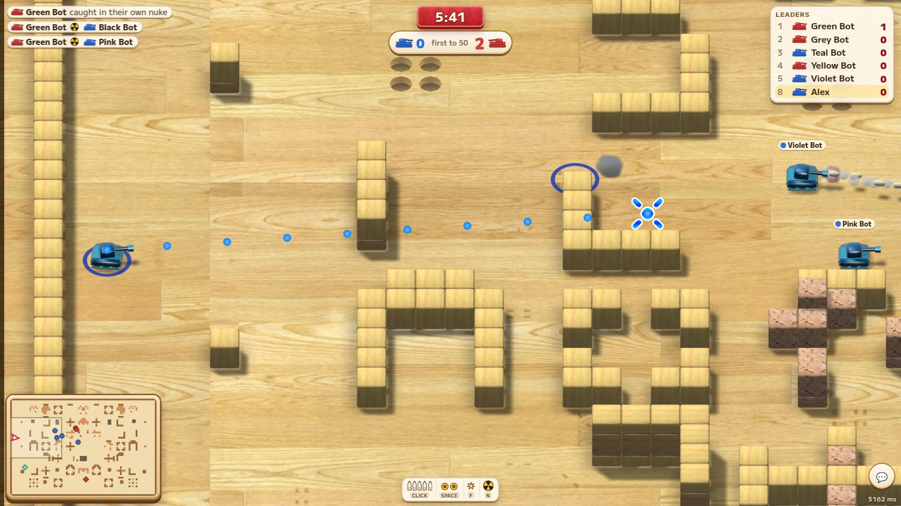
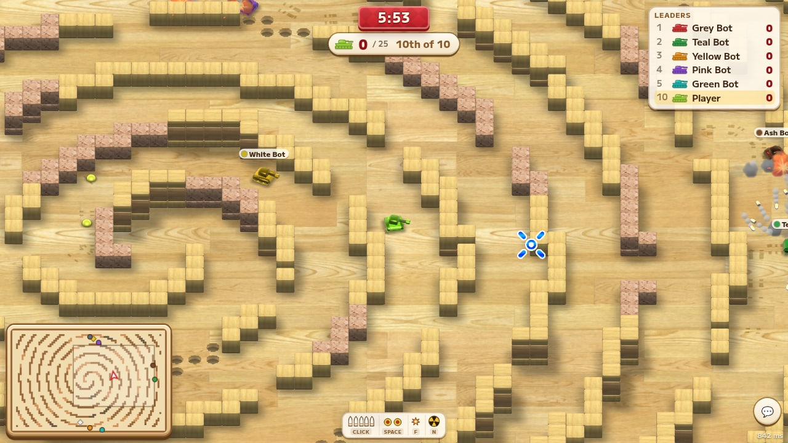
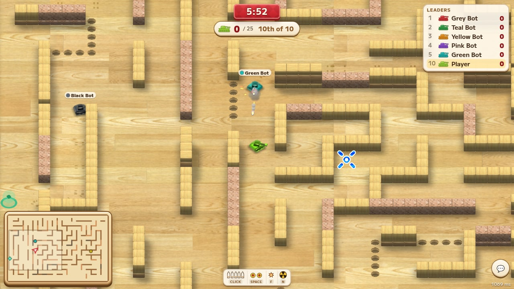
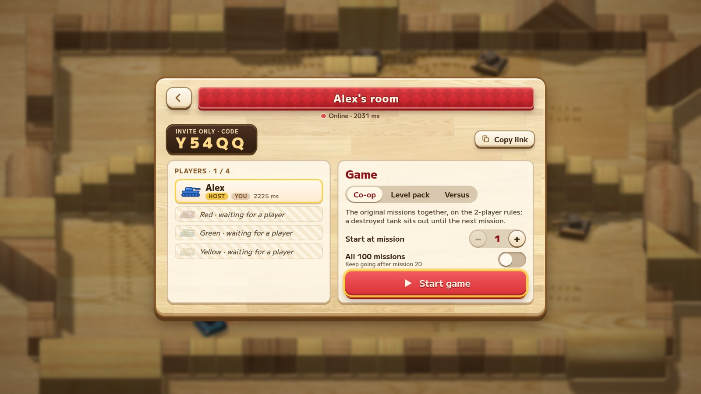
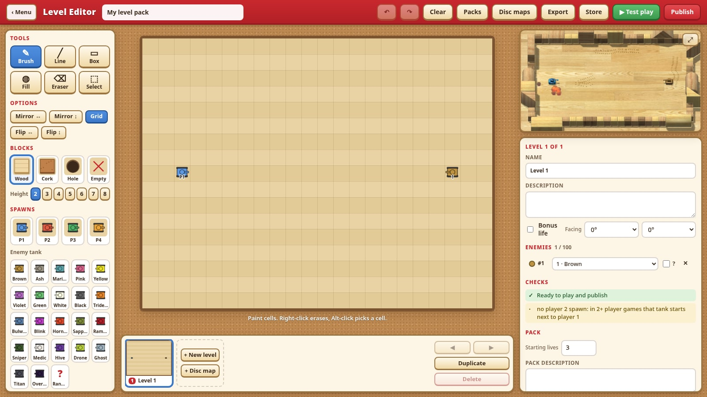

<h1 align="center">Tanks!</h1>

Toy tank battles in the browser. <a href="https://tanks.wohlbruck.dev"><b>Play now at tanks.wohlbruck.dev</b></a>

A faithful remake of the classic tank minigame, rebuilt for the web: little tanks on a wooden table, shells that bounce off the walls once, and mines you leave behind you. Play the original missions on your own or with a friend, then take it online.

## What's inside

- **Campaign.** The original 100 missions, played exactly the way they always were, solo or with a second player.
- **Online with friends.** Co-op or head to head, with a room code or an invite link.
- **Arena.** One huge map with up to 40 players and bots. Four modes: free-for-all, teams, battle royale and elimination. Power-ups turn you into special tanks, and you get flares, shields and one airstrike nuke per match.
- **Big maps.** Procedurally built arenas, from cork forests and sinkholes to spirals, bullseyes and labyrinths.
- **Level editor.** Build your own missions and share them in the community levels.
- **Achievements**, kill streaks, leaderboards and a map vote at the end of every match.
- **Plays anywhere.** Keyboard and mouse, gamepad or touch, in any window shape. Install it as an app on your phone.

## Screenshots

| | |
|---|---|
|  |  |
|  |  |
|  |  |
|  | |

## Run it yourself

None of the original game's files are in this repository. The build converts the models, levels and sounds from your own copy of the disc. [docs/development.md](docs/development.md) covers the asset pipeline, running it locally and how releases are deployed.

## Credits

Made with ❤️ by [Alex Wohlbruck](https://alex.wohlbruck.com). If you enjoy it, you can [buy me a coffee](https://buymeacoffee.com/alexwohlbruck).

Built with [three.js](https://threejs.org), [Bun](https://bun.sh), [Vite](https://vite.dev) and TypeScript. A non-commercial fan project.
